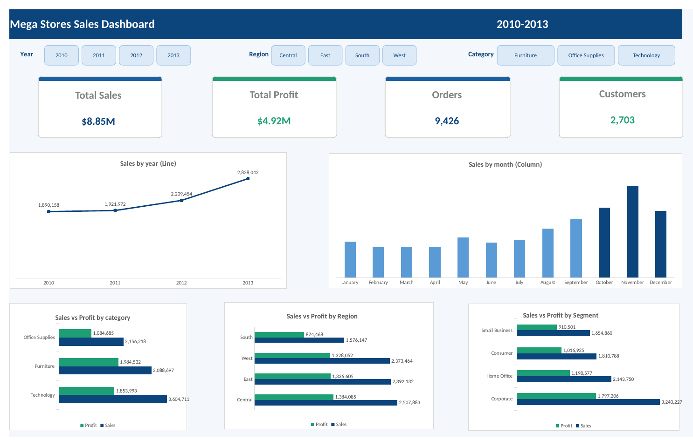
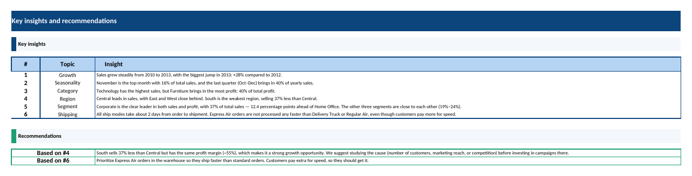
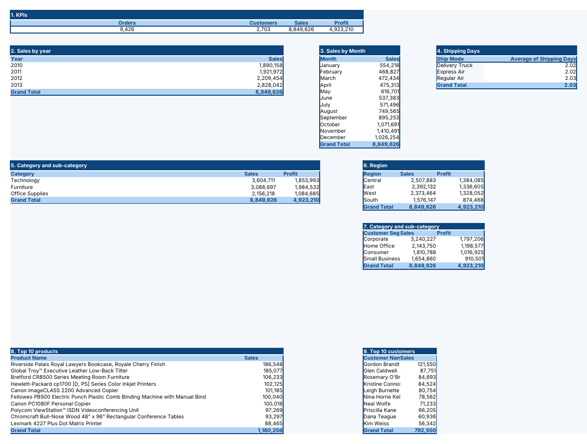

# 🏬 Mega Stores Sales Analysis (Excel)

## Overview
An end-to-end sales analysis project in **Microsoft Excel**: from raw transactions to a cleaned dataset, pivot-table analysis, an interactive dashboard and business recommendations. The data covers **9,426 orders** from **2,703 customers** between **2010 and 2013**.

## Workflow
1. **Orders:** raw sales transactions (orders, customers, products, regions, shipping, sales and profit).
2. **Cleaned Data:** cleaned and prepared data, with new calculated columns such as **Shipping Days**, **Year** and **Month**.
3. **Pivot Tables:** analysis of KPIs, sales by year and month, category, region, customer segment, shipping days, and top 10 products and customers.
4. **Dashboard:** KPI cards, pivot charts and **slicers** for Year, Region and Category.
5. **Insights:** key findings and recommendations.

## KPIs
| Total Sales | Total Profit | Orders | Customers |
|---|---|---|---|
| **$8.85M** | **$4.92M** | **9,426** | **2,703** |

## Key Insights
- **Growth:** sales grew every year from 2010 to 2013, with the biggest jump in 2013 (**+28%** vs 2012).
- **Seasonality:** **November** is the top month (16% of total sales) and **Q4** brings in **40%** of yearly sales.
- **Category:** **Technology** has the highest sales, but **Furniture** brings in the most profit (40% of total profit).
- **Region:** **Central** leads in sales; **South** is the weakest, selling **37% less** than Central.
- **Segment:** **Corporate** leads in both sales and profit with **37%** of total sales.
- **Shipping:** all ship modes take about **2 days**, so **Express Air** is not faster than standard shipping even though customers pay more.

## Recommendations
- **South region:** it sells 37% less than Central but has the same profit margin (~55%), which makes it a strong growth opportunity. Study the cause (number of customers, marketing reach or competition) before investing in campaigns there.
- **Express Air:** prioritize Express Air orders in the warehouse so they ship faster than standard orders.

## Pivot Tables

## Files
| File | Description |
|---|---|
| `Mega_Stores_Sales_Analysis.xlsx` | Excel workbook: raw data, cleaned data, pivot tables, dashboard and insights |
| `dashboard.png` | Dashboard screenshot |
| `insights.png` | Insights and recommendations |
| `pivot_tables.png` | Pivot tables analysis |

## Tools
Microsoft Excel · Data Cleaning · Pivot Tables · Pivot Charts · Slicers

---
👤 **Youssef Fathy** · [LinkedIn](https://www.linkedin.com/in/youssef-fathy-195ba61a4)
